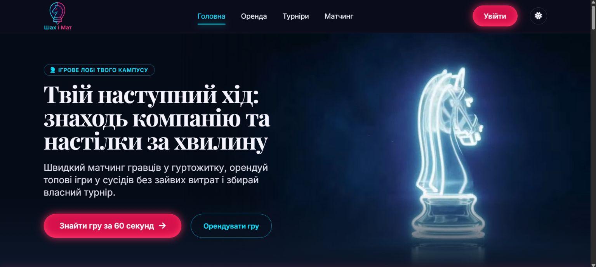

# Шах і Мат — настільні ігри у гуртожитку

Вебсайт сервісу для студентів, які живуть у гуртожитках: можна **орендувати настільну гру** в сусідів, **знайти гравців** на вечір і **зареєструватися на турнір**. Проєкт виконано в межах курсу «Технології веброзробки та дизайну» (НУ «Львівська політехніка»).

**Демо:**
- Netlify — https://shakh-i-mat.netlify.app/
- GitHub Pages — https://SpellRey.github.io/shakh-i-mat/
- Vercel — https://shakh-i-mat.vercel.app/



## Можливості

- **Каталог ігор** — фільтри за жанром, кількістю гравців і ціною, пошук, сортування; сторінка гри зі схожими іграми.
- **Оренда** — вибір власника й дат, розрахунок вартості, сторінки «Оренду підтверджено» та «Гра зайнята».
- **Турніри** — вкладки «Найближчі / Минулі», картка турніру, реєстрація, стан «Місць немає».
- **Матчинг** — пошук гравців за грою, гуртожитком, часом і рівнем; запрошення до гри.
- **Медіакомпоненти на головній** — карусель відгуків (Swiper), галерея колекції з переглядом на весь екран і зумом (Fancybox), ефект друкування слогана в Hero (Typed.js).
- **Форма зворотного зв’язку** — перевірка полів у браузері (RegEx для імені, email і телефону `+380XXXXXXXXX`), підказки під полями, автоформат номера, модальне вікно після успішної перевірки.
- **Світла й темна тема** — перемикач у шапці, вибір зберігається в браузері; за замовчуванням береться тема системи.
- **Адаптивна верстка** — від 320 px (телефон) до широких моніторів, бургер-меню до 1024 px.
- **Доступність** — семантичні теги, ARIA-вкладки з керуванням стрілками, видимий фокус, режим «менше анімації».

> Вхід, реєстрація, оплата й форма зворотного зв’язку — демонстраційні: сайт статичний, дані нікуди не надсилаються.

## Сторінки

| Розділ | Файли |
|---|---|
| Головна | `index.html` |
| Оренда | `catalog.html`, `game.html`, `booking.html`, `rent-confirmed.html`, `rent-unavailable.html` |
| Турніри | `tournaments.html`, `tournament.html`, `tournament-register.html`, `tournament-confirmed.html`, `tournament-full.html` |
| Матчинг | `matching.html`, `match-invite.html`, `match-confirmed.html`, `match-no-players.html` |
| Контакти | `contact.html` — форма зворотного зв’язку з валідацією |
| Інше | `login.html`, `register.html`, `credits.html` (джерела фото), `404.html` |

## Технології

- **HTML5** — семантична розмітка (`header`, `nav`, `main`, `section`, `article`, `footer`).
- **Tailwind CSS 3** (CDN) — утилітарні класи; спільна тема (кольори, шрифти, тіні) у `js/tailwind-config.js`.
- **CSS** — змінні кольорів для світлої й темної теми, фон і окремі стилі у `css/custom-styles.css`.
- **JavaScript** (без бібліотек) — тема, меню, фільтри каталогу, калькулятор оренди, вкладки, валідація форм.
- **Swiper.js 11, Fancybox 5, Typed.js 2** — JS-бібліотеки без jQuery, підключені через CDN jsDelivr з фіксованими версіями та SRI-хешами; ініціалізація в `js/main.js`.
- **Google Fonts** (Playfair Display, Inter) і **Font Awesome 6** — шрифти та іконки.
- **Figma** — макети й прототип сторінок; **Leonardo AI** — відео з конем на головній.

## Структура

```
shakh-i-mat/
├── index.html            головна сторінка
├── *.html                інші сторінки (див. таблицю вище)
├── css/
│   └── custom-styles.css теми, фон, анімації
├── js/
│   ├── tailwind-config.js тема Tailwind (кольори через CSS-змінні)
│   ├── theme-init.js     застосовує тему ще до показу сторінки
│   ├── theme.js          перемикач світлої/темної теми
│   ├── menu.js           мобільне меню
│   ├── data.js           ігри, гравці, турніри
│   ├── pages.js          логіка окремих сторінок
│   ├── main.js           ініціалізація Swiper, Fancybox і Typed.js на головній
│   └── validation.js     валідація форми зворотного зв’язку
└── assets/
    ├── icons/            SVG-іконки переваг
    ├── images/           логотип, фон, заставка відео
    └── video/            відео з конем (WebM і MP4)
```

## Як запустити

Збирати нічого не потрібно — це статичний сайт.

1. Склонувати репозиторій:
   ```bash
   git clone https://github.com//SpellRey/shakh-i-mat.git
   ```
2. Відкрити `index.html` у браузері або запустити через розширення **Live Server** у VS Code (так коректно працюють усі переходи між сторінками).

Для публікації на GitHub Pages / Netlify / Vercel (Framework Preset «Other») достатньо вказати гілку `main` і корінь репозиторію (`/`), команда збірки не потрібна.

## Джерела

- Фото настільних ігор — Wikimedia Commons (ліцензії CC, автори вказані на сторінці `credits.html`).
- Відео з шаховим конем згенеровано в Leonardo AI.

## Автор

**Паславський Павло**, група ПП-23, НУ «Львівська політехніка», 2026.
